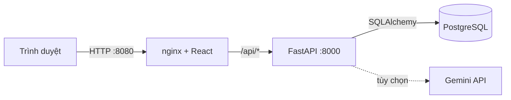
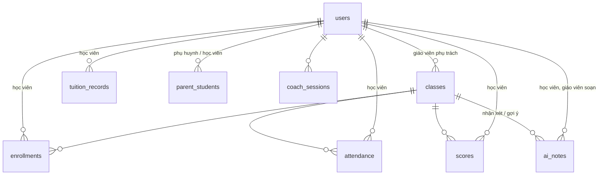

# Hướng dẫn chạy dự án HKII và chuẩn bị thuyết trình

Tài liệu gồm 4 phần: **(1)** chạy dự án, **(2)** kiểm tra nhanh sau khi chạy, **(3)** kịch bản demo 8 phút,
**(4)** câu hỏi thường gặp khi bảo vệ. Bài thuyết trình (slide) nằm ở `Documentations/EduCenter_Group03_Presentation.pptx`.

---

## 1. Chạy dự án

### 1.1 Yêu cầu

| Công cụ | Ghi chú |
|---|---|
| **Docker Desktop** | Bật xong, chờ biểu tượng báo "Engine running" |
| **Git** | Để clone repo |
| RAM trống | Khoảng 2 GB |
| Cổng rảnh | `8080` (web), `8000` (API), `5433` (PostgreSQL) |

Không cần cài Python, Node hay PostgreSQL trên máy: tất cả chạy trong Docker.

### 1.2 Các bước

```bash
git clone https://github.com/thaiphatcaifa/HKII-FastAPI.git
cd HKII-FastAPI

# (khuyến nghị) tạo file cấu hình riêng, đổi mật khẩu DB và SECRET_KEY
cp .env.example .env

docker compose up --build
```

- Lần đầu mất vài phút vì phải tải image và cài thư viện.
- Chờ đến khi log của `api` hiện `Application startup complete`. Lúc này API đã tự tạo bảng (Alembic) và nạp dữ liệu mẫu.
- `api` có healthcheck gọi `/health`; `web` chỉ khởi động sau khi `api` báo `healthy` (xem bằng `docker compose ps`).
- Nếu muốn chạy nền: `docker compose up -d --build`.

> Trên Windows PowerShell, thay `cp` bằng `Copy-Item .env.example .env`.

### 1.3 Địa chỉ sau khi chạy

| Thành phần | Địa chỉ |
|---|---|
| **Giao diện web** | http://localhost:8080 |
| Tài liệu API (Swagger) | http://localhost:8000/docs |
| Kiểm tra sức khỏe API | http://localhost:8000/health |
| PostgreSQL | `localhost:5433`, user/DB/mật khẩu theo `.env` (mặc định `hkii` / `hkii` / `hkii_dev`) |

### 1.4 Tài khoản mẫu

Mật khẩu chung: **`Hkii@12345`** (đặt bằng `SEED_PASSWORD` trong `.env`). Toàn bộ là dữ liệu giả.

| Vai trò | Tên đăng nhập | Ghi chú |
|---|---|---|
| Quản trị viên | `admin` | Toàn quyền |
| Giáo viên | `gv.lan` | Phụ trách IELTS-A1, IELTS-B2 |
| Giáo viên | `gv.minh` | Phụ trách GIAOTIEP-1 |
| Học viên | `hv01` … `hv08` | |
| Phụ huynh | `ph.an` | Con: hv01 |
| Phụ huynh | `ph.ha` | Con: hv02 |

### 1.5 Dừng, chạy lại, xóa dữ liệu

```bash
docker compose stop              # dừng, giữ dữ liệu
docker compose up -d             # chạy lại
docker compose down              # tắt hẳn container, VẪN giữ dữ liệu DB
docker compose down -v           # tắt và XÓA dữ liệu DB (lần sau nạp lại dữ liệu mẫu)
docker compose logs -f api       # xem log API
```

Sửa code backend hoặc frontend xong thì chạy lại `docker compose up -d --build`.

### 1.6 Chạy test

Code nằm trong image, nên sau khi sửa code hoặc test phải chạy `docker compose build api` trước.

**Trên SQLite (mặc định, không đụng PostgreSQL):**

```bash
docker compose run --rm --no-deps api python -m pytest -q

# kèm độ phủ từng file (pytest-cov)
docker compose run --rm --no-deps api python -m pytest -q --cov=app --cov-report=term-missing
```

**Trên PostgreSQL thật:** dùng CSDL riêng `hkii_test`, không dùng CSDL chính `hkii`.

```bash
docker compose up -d db
docker compose exec db createdb -U hkii hkii_test
docker compose run --rm --no-deps -e TEST_DATABASE_URL=postgresql+psycopg://hkii:hkii_dev@db:5432/hkii_test api python -m pytest -q
```

- Lệnh `createdb` chỉ cần chạy một lần; chạy lại sẽ báo `already exists`, bỏ qua được. Sau `docker compose down -v` thì phải tạo lại.
- Lệnh trên dùng mật khẩu mặc định khi **không có** file `.env`. Nếu đã chép `.env.example` thành `.env` thì thay `hkii_dev` bằng giá trị `POSTGRES_PASSWORD` trong `.env` (file mẫu là `doi_mat_khau_nay`), và đổi cả `POSTGRES_USER` nếu đã sửa.
- Mỗi test xóa và tạo lại toàn bộ bảng, nên `conftest.py` từ chối chạy nếu tên CSDL không có chữ `test` hoặc URL trùng `DATABASE_URL`.

Kết quả mong đợi ở cả hai lệnh: `120 passed`, độ phủ tổng 98%. Mỗi lần chạy mất khoảng 2 phút vì băm mật khẩu bcrypt cho dữ liệu mẫu ở mỗi test.

**CI:** `.github/workflows/ci.yml` chạy mỗi lần push và pull request: pytest trên SQLite, pytest trên PostgreSQL (service container), cả hai kèm `--cov=app --cov-fail-under=90` (độ phủ dưới 90% thì CI báo đỏ), `npm ci` và `npm run build`.

### 1.7 Bật Gemini cho AI Coach và AI hỗ trợ giáo viên (tùy chọn)

Không cần key vẫn chạy (bộ chấm và bộ soạn theo luật). Muốn dùng Gemini, điền vào `.env`:

```
GEMINI_API_KEY=khoa_cua_ban
```

rồi `docker compose up -d --build`. **Không commit file `.env`** (đã nằm trong `.gitignore`). Nếu Gemini lỗi hoặc trả sai định dạng, hệ thống tự rơi về bộ theo luật; nguyên nhân (chỉ loại lỗi, không có nội dung bài) nằm trong log `hkii.coach` / `hkii.ai`.

### 1.8 Chạy riêng giao diện để phát triển (tùy chọn)

Cần Node 20+ và API đang chạy ở cổng 8000:

```bash
cd frontend
npm install
npm run dev        # http://localhost:5173, tự chuyển /api sang http://localhost:8000
```

### 1.9 Xử lý sự cố

| Triệu chứng | Nguyên nhân và cách xử lý |
|---|---|
| `failed to connect to the docker API` | Docker Desktop chưa chạy. Mở Docker Desktop, chờ "Engine running", chạy lại lệnh |
| Web báo **502 Bad Gateway** | `web` đã chờ `api` healthy nên hiếm gặp; nếu gặp là API vừa khởi động lại. Xem `docker compose ps` (cột STATUS của `api` phải là `healthy`), chờ 10 đến 20 giây rồi tải lại |
| `port is already allocated` | Cổng bị chiếm, có thể do một bản HKII cũ tự chạy lại khi bật Docker (xem bằng `docker compose ls`, dừng bản đó bằng `docker compose -p <tên> stop`). Hoặc đổi trong `.env`: `WEB_PORT=8081`, `API_PORT=8001`, `DB_PORT=5434` |
| Đăng nhập bị báo **423** (khóa tạm) | Nhập sai mật khẩu 5 lần sẽ bị khóa 15 phút. Đợi hoặc `docker compose down -v` để nạp lại dữ liệu |
| Đổi `SEED_PASSWORD` mà không có tác dụng | Dữ liệu mẫu chỉ nạp khi DB còn trống. Chạy `docker compose down -v` rồi `up` lại |
| Muốn làm lại từ đầu | `docker compose down -v && docker compose up --build` |
| API dừng và log báo `APP_ENV=prod nhưng SECRET_KEY...` | Đang chạy `prod` mà khóa còn giá trị mặc định. Đặt `SECRET_KEY` và `SEED_PASSWORD` riêng trong `.env` (xem mục 1.10) |

### 1.10 Môi trường chạy `APP_ENV`

Đặt trong `.env`, nhận `dev` hoặc `prod`, mặc định `dev`. Giá trị khác làm API báo lỗi ngay khi khởi động.

| `APP_ENV` | `SECRET_KEY` hoặc `SEED_PASSWORD` còn giá trị mặc định (hoặc để trống) |
|---|---|
| `dev` | API vẫn chạy, log có dòng `WARNING` nêu tên biến |
| `prod` | API dừng khởi động, log nêu tên biến cần đổi (không in giá trị) |

Do `docker-compose.yml` đặt `restart: unless-stopped`, container sẽ tự thử lại cho đến khi sửa xong `.env`. Lúc đó chạy `docker compose up -d` để áp dụng.

### 1.11 Chạy trên Kubernetes bằng minikube (tùy chọn)

Thư mục `k8s/` chứa manifest cho cùng 3 thành phần như Docker Compose:

| File | Nội dung |
|---|---|
| `00-configmap.yaml` | ConfigMap `hkii-config`: cấu hình không bí mật (`APP_ENV`, `POSTGRES_USER`, `POSTGRES_DB`, `GEMINI_MODEL`, `AI_DAILY_LIMIT`, `SEED_ON_START`, ...) |
| `01-secret.example.yaml` | Secret **mẫu** `hkii-secret`, chỉ có chỗ trống, không chứa giá trị thật. Không commit bản đã điền |
| `10-db.yaml` | PVC `hkii-pgdata` (1 Gi) + Deployment `db` (postgres:16-alpine, probe `pg_isready`) + Service `db` |
| `20-api.yaml` | Deployment `api` (initContainer chờ db, liveness và readiness gọi `GET /health`) + Service `api` cổng 8000 |
| `30-web.yaml` | Deployment `web` (nginx, readiness gọi `/api/health`, liveness gọi `/`) + Service `web` kiểu NodePort 30080 |

Cần cài sẵn **minikube** và **kubectl** (Docker Desktop đã kèm kubectl). Các bước, chạy ở thư mục gốc repo:

```bash
# 1. Khởi động cụm
minikube start

# 2. Build image ngay trong minikube (manifest dùng tên hkii-api:1.0 và hkii-web:1.0)
minikube image build -t hkii-api:1.0 ./backend
minikube image build -t hkii-web:1.0 ./frontend

# 3. Tạo Secret bằng lệnh (không ghi mật khẩu ra file). Thay <mat-khau-db> và <chuoi-bi-mat> bằng giá trị riêng;
#    <mat-khau-db> phải giống nhau ở POSTGRES_PASSWORD và DATABASE_URL.
kubectl create secret generic hkii-secret \
  --from-literal=POSTGRES_PASSWORD=<mat-khau-db> \
  --from-literal=DATABASE_URL=postgresql+psycopg://hkii:<mat-khau-db>@db:5432/hkii \
  --from-literal=SECRET_KEY=<chuoi-bi-mat> \
  --from-literal=SEED_PASSWORD=Hkii@12345 \
  --from-literal=GEMINI_API_KEY=

# 4. Triển khai (không apply file secret mẫu vì Secret đã tạo ở bước 3)
kubectl apply -f k8s/00-configmap.yaml -f k8s/10-db.yaml -f k8s/20-api.yaml -f k8s/30-web.yaml
kubectl rollout status deploy/api
kubectl get pods,svc,pvc

# 5. Mở giao diện: giữ cửa sổ này mở rồi vào http://localhost:8081
kubectl port-forward svc/web 8081:80
```

- Trên Windows (minikube chạy bằng Docker), NodePort không mở thẳng từ máy được, nên dùng `kubectl port-forward` như bước 5 (hoặc `minikube service web --url`).
- Kiểm tra: `curl http://localhost:8081/api/health` trả `{"status":"ok"}`, đăng nhập bằng tài khoản mẫu như mục 1.4.
- Thử tự phục hồi: `kubectl delete pod -l app=api`, Kubernetes tạo Pod mới và chỉ đưa vào Service khi `/health` trả 200.
- Thử lưu trữ bền: tạo một lớp, `kubectl delete pod -l app=db`, lớp vẫn còn vì dữ liệu nằm trên PVC.
- Sửa code thì build lại image (bước 2) rồi `kubectl rollout restart deploy/api deploy/web`.
- Gỡ toàn bộ: `kubectl delete -f k8s/00-configmap.yaml -f k8s/10-db.yaml -f k8s/20-api.yaml -f k8s/30-web.yaml` và `kubectl delete secret hkii-secret` (xóa cả PVC nên mất dữ liệu). Dừng cụm: `minikube stop`.

---

## 2. Kiểm tra nhanh sau khi chạy

```bash
curl http://localhost:8000/health
# {"status":"ok"}

curl -X POST http://localhost:8000/auth/login -H "Content-Type: application/json" \
     -d '{"username":"admin","password":"Hkii@12345"}'
# trả về access_token (JWT) và thông tin người dùng
```

Sau đó mở http://localhost:8080, đăng nhập `gv.lan` và kiểm tra thấy 2 lớp (IELTS-A1, IELTS-B2).

---

## 3. Kịch bản demo 8 phút

Chuẩn bị trước: chạy `docker compose up -d` ít nhất 1 phút trước giờ thuyết trình (kiểm `docker compose ps`: `api` là `healthy`),
mở sẵn 2 tab trình duyệt (http://localhost:8080 và http://localhost:8000/docs), cửa sổ trình duyệt để 1366x768 cho khớp máy chiếu,
đăng xuất mọi tài khoản. Muốn dữ liệu sạch như lúc đầu: `docker compose down -v && docker compose up -d`.

| Phút | Việc làm | Điều cần nói |
|---|---|---|
| 0:00 đến 0:40 | Mở `docker compose ps` cho thấy 3 container `db`, `api` (healthy), `web`; mở http://localhost:8080 | "Hệ thống gồm 3 container: PostgreSQL, FastAPI, React sau nginx. API có healthcheck, giao diện chỉ bật khi API đã sẵn sàng." |
| 0:40 đến 1:40 | Đăng nhập **`admin`**. Trang **Tổng quan**: số lớp, học viên, học phí, biểu đồ tròn tỷ lệ đã thu. Mở **Lớp học** → lớp **IELTS-A1** → bấm **Xóa lớp** → **Xóa lớp** trong hộp xác nhận | "Lớp còn học viên, điểm danh, điểm số nên máy chủ trả 409 kèm lý do, giao diện hiện thông báo đỏ. Chỉ lớp trống mới xóa được." |
| 1:40 đến 2:40 | **Học phí**: lọc **Quá hạn**; bấm bút chì ở một khoản chưa đóng, đổi số tiền → **Lưu thay đổi**; bấm **Ghi nhận đã đóng** ở một khoản khác | "Học phí chỉ admin quản lý. Khoản chưa đóng thì sửa hoặc xóa được; khoản đã đóng là chứng từ nên không có nút sửa, xóa, gọi API cũng bị 409." |
| 2:40 đến 3:40 | Đăng xuất, đăng nhập **`gv.lan`**. Mở **IELTS-A1** → tab **Điểm danh** → đổi 1 học viên sang "Vắng" → **Lưu điểm danh** | "Giáo viên chỉ thấy 2 lớp mình phụ trách. Lưu lại cùng một ngày sẽ cập nhật chứ không tạo trùng." |
| 3:40 đến 4:30 | Tab **Điểm số** → **Thêm điểm**. Tab **Báo cáo** → **Xuất Excel** | "Báo cáo tính bằng Python (pandas) từ PostgreSQL: chuyên cần và điểm trung bình thang 10." |
| 4:30 đến 5:30 | Tab **Cảnh báo**: đủ 3 mức Rủi ro cao, Rủi ro trung bình, Ổn định; bấm **Gợi ý hành động** ở học viên rủi ro cao | "Mức rủi ro tính bằng luật nên giải thích được từng lý do; AI chỉ gợi ý 3 hành động và không nhận tên học viên." |
| 5:30 đến 6:20 | Đăng xuất, đăng nhập **`ph.an`** → **Tổng quan** có thẻ nhận xét giáo viên đã công bố; xem **Chuyên cần**, **Điểm số**, **Học phí** của con | "Phụ huynh chỉ xem được con mình và chỉ thấy nhận xét đã được giáo viên duyệt, công bố." |
| 6:20 đến 7:20 | Đăng nhập **`hv01`** → **AI Coach**: dán đoạn văn có vài lỗi (ví dụ `i like a apple. I read the the book.`) → **Chấm bài** | "Kết quả có điểm từng tiêu chí và lỗi kèm câu sửa. Có Gemini thì Gemini chấm; không có key hoặc lỗi thì tự chuyển sang bộ luật. Giới hạn 20 lượt/ngày." |
| 7:20 đến 8:00 | Trang **Tài khoản** → đổi bảng màu **Xanh biển**; mở http://localhost:8000/docs, bấm thử `/health` | "Giao diện có 3 bảng màu lưu trên trình duyệt. API tự sinh tài liệu OpenAPI, tổng cộng 52 API. Backend có 120 test tự động, độ phủ 98%, chạy trên cả SQLite và PostgreSQL." |

**Demo mở rộng (nếu còn thời gian): quy trình nhận xét AI.** Đăng nhập **`gv.lan`**, mở lớp **IELTS-A1**:

1. Tab **Nhận xét AI**: chọn học viên → **AI soạn nháp** → sửa vài chữ → **Lưu** → **Công bố**. *Nói:* "AI chỉ soạn nháp, giáo viên duyệt rồi mới công bố."
2. Bấm **Thu hồi** ở nhận xét của `hv01`: đăng nhập lại **`ph.an`**, thẻ nhận xét biến mất. *Nói:* "Học viên, phụ huynh chỉ đọc bản đang công bố."
3. Gõ một địa chỉ không có (ví dụ http://localhost:8080/abc): hiện trang **404** trong khung ứng dụng.
4. Kubernetes: `kubectl get pods` cho thấy 3 Pod (mục 1.11); `kubectl delete pod -l app=api` rồi xem Pod mới tự lên.

**Phương án dự phòng nếu demo hỏng:** dùng ảnh chụp màn hình trong slide và mở Swagger để minh họa API.

---

## 4. Câu hỏi thường gặp khi bảo vệ

**Vì sao chọn FastAPI?**
Tự sinh tài liệu OpenAPI (`/docs`), kiểm tra dữ liệu đầu vào bằng Pydantic, khai báo kiểu rõ ràng, dễ viết test.
Python cũng thuận lợi cho phần AI và báo cáo (pandas).

**Vì sao PostgreSQL mà không dùng Firebase Realtime Database như hệ thống cũ?**
Dữ liệu có quan hệ rõ ràng (lớp – học viên nhiều-nhiều, điểm danh, điểm số, học phí), cần khóa ngoại, ràng buộc duy nhất,
giao dịch (ACID) và truy vấn tổng hợp bằng SQL cho báo cáo. Cây JSON của RTDB phải dựng thủ công những thứ này.

**Vì sao tách `crud/` khỏi `routers/`?**
Router chỉ nhận request, kiểm tra quyền và trả lỗi HTTP; `crud/` giữ toàn bộ truy vấn CSDL. Nhờ vậy một câu truy vấn chỉ viết ở một nơi,
dễ test và dễ đổi CSDL; đúng 4 lớp `models, schemas, crud, endpoints` của tài liệu môn học.

**Phân trang làm thế nào?**
Các danh sách nhận `skip` và `limit` (mặc định 100, tối đa 500); tổng số bản ghi trả qua header `X-Total-Count`.
Giao diện dùng `api.getAll()` gọi lần lượt các trang cho tới khi đủ.

**Khác nhau giữa PUT và PATCH?**
PUT thay thế toàn bộ tài nguyên (`PUT /classes/{id}`), PATCH chỉ sửa các trường được gửi (`PATCH /classes/{id}`, `PATCH /tuition/{id}`).

**Vì sao xóa lớp lại trả 409 thay vì xóa luôn?**
Khóa ngoại của điểm danh, điểm số, nhận xét AI đặt `ON DELETE CASCADE`, học phí đặt `SET NULL`: xóa lớp còn dữ liệu sẽ kéo theo mất lịch sử học tập hoặc làm khoản học phí mất liên kết lớp.
Vì vậy `DELETE /classes/{id}` đếm dữ liệu còn gắn với lớp; còn thì trả `409 Conflict` kèm số lượng từng loại, chỉ lớp trống mới xóa. Tương tự, khoản học phí đã đóng là chứng từ nên không sửa, không xóa.

**Lỗi và log được xử lý ra sao?**
Lỗi nghiệp vụ là các `AppError` (`errors.py`) và luôn trả `{"detail": ...}`; lỗi bất ngờ trả `500` chung chung, chi tiết chỉ ghi vào log.
Log ghi mỗi request kèm thời gian và cảnh báo request chậm, nhưng không ghi mật khẩu, token hay nội dung bài viết.

**Nút Authorize trên Swagger hoạt động ra sao?**
Dự án dùng `OAuth2PasswordBearer(tokenUrl="auth/token")`: Swagger gửi username/password dạng form tới `POST /auth/token`, nhận JWT rồi tự gắn vào mọi request.
Giao diện web vẫn dùng `POST /auth/login` (JSON); hai endpoint dùng chung hàm `authenticate`.

**`BackgroundTasks` dùng vào việc gì?**
Tự động đánh dấu học phí quá hạn (thay cho `tuitionAutoOverdue` của Firebase). Sau khi trả kết quả xem học phí, FastAPI chạy việc nền này mà người dùng không phải chờ; có giới hạn tần suất để không quét CSDL ở mỗi request.

**Nhập CSV bằng `UploadFile` có an toàn không?**
Chỉ admin dùng được; giới hạn 1 MB và 100 dòng; kiểm tra từng dòng bằng chính schema `UserCreate`; không cho tạo admin; dòng lỗi hoặc trùng được liệt kê chứ không làm hỏng cả file. Hạn chế: mật khẩu nằm dạng chữ thường trong file nên phải xóa file sau khi nhập.

**Bảo mật được làm thế nào?**
Mật khẩu băm bcrypt; đăng nhập trả JWT (HS256, hết hạn sau 8 giờ); khóa tạm 15 phút sau 5 lần sai;
sai mật khẩu hay sai tên đăng nhập đều nhận cùng một thông báo 401 (chưa kín hoàn toàn: tài khoản có thật bị khóa sau 5 lần sai sẽ trả 423, nên vẫn suy ra được tài khoản tồn tại; hướng cải thiện là giới hạn tần suất theo IP); phân quyền theo vai trò kiểm tra ở backend (`deps.py`),
không dựa vào giao diện; khóa và mật khẩu lấy từ biến môi trường, `.env` không được commit.
Khi `APP_ENV=prod`, API từ chối khởi động nếu `SECRET_KEY` hoặc `SEED_PASSWORD` còn giá trị mặc định công khai trong repo.

**Khi nào dùng `async def`, khi nào dùng `def`?**
SQLAlchemy của dự án là đồng bộ, nên phần lớn endpoint là `def`: FastAPI tự chạy chúng trong threadpool và event loop không bị chặn.
`POST /ai/risk/advice` là ví dụ `async def` vì phần lớn thời gian của nó là chờ Gemini: dùng `httpx.AsyncClient` để nhường event loop, truy vấn CSDL đi qua `run_in_threadpool`, và session được đóng trước khi gọi Gemini để không giữ kết nối CSDL trong lúc chờ.
Sai lầm cần tránh là gọi truy vấn đồng bộ trực tiếp trong `async def`, vì khi đó toàn bộ API phải chờ theo.

**Hạn chế còn lại?**
JWT đang lưu ở `localStorage` (có rủi ro XSS, hướng cải thiện: cookie `HttpOnly`); chưa có refresh token; chưa có CAPTCHA;
mật khẩu mẫu chỉ dành cho demo; chưa có test giao diện tự động trong CI (nhóm đã rà giao diện bằng trình duyệt tự động ngoài CI).

**Dữ liệu mẫu lấy từ đâu?**
Toàn bộ là dữ liệu giả do chương trình tự sinh (`backend/app/seed.py`), không lấy từ hệ thống thật.

**Thay đổi cấu trúc CSDL thì làm thế nào?**
Dùng Alembic: sửa `models.py`, chạy `alembic revision --autogenerate`, commit file migration. Container API tự chạy `alembic upgrade head` khi khởi động.

**Có mở rộng được không?**
API không giữ trạng thái (xác thực bằng JWT), nên có thể chạy nhiều bản sao phía sau nginx. Thư mục `k8s/` đã chạy thử trên minikube:
Deployment có liveness/readiness gọi `/health`, PostgreSQL dùng PVC, mật khẩu nằm trong Secret. PostgreSQL có thể chuyển sang dịch vụ quản lý.

**AI Coach hoạt động ra sao?**
Gửi bài viết/bài nói (dạng văn bản) lên `/coach/feedback` và nhận về điểm 0-10 cho 4 tiêu chí (ngữ pháp, từ vựng, mạch lạc, triển khai ý),
danh sách lỗi kèm câu sửa và 2 gợi ý. Nếu có `GEMINI_API_KEY` thì Gemini chấm và trả JSON; nếu không có hoặc lỗi thì dùng bộ chấm theo luật.
Mỗi lượt được lưu trong bảng `coach_sessions` (cột `analysis` dạng JSON và `overall`), mỗi người tối đa 20 lượt/ngày; `/coach/progress` trả điểm tổng theo thời gian để vẽ biểu đồ.

**Làm sao tin được kết quả Gemini trả về?**
Không tin mù quáng: backend kiểm tra bằng Pydantic (`CoachAnalysis`), ép điểm về 0-10, bỏ tiêu chí lạ, và loại mọi "lỗi" có đoạn trích không nằm trong bài của học viên
(chống Gemini bịa). Nếu JSON hỏng hoặc thiếu điểm thì tự rơi về bộ chấm theo luật. Lời nhắc cũng dặn bỏ qua mệnh lệnh nằm trong bài để giảm rủi ro "prompt injection".

**Bộ chấm theo luật chấm được gì, không chấm được gì?**
Chỉ ước lượng từ vựng (độ đa dạng, từ lặp), mạch lạc (độ dài câu, từ nối) và triển khai ý (số từ); **không chấm ngữ pháp** vì luật không hiểu được ngữ pháp.
Nó chỉ báo vài lỗi gần như chắc chắn: viết thường `i`, `a`/`an`, từ lặp liền nhau, chữ đầu câu. Điểm theo luật được tô màu khác trên biểu đồ để không bị nhầm với điểm của Gemini.

**AI hỗ trợ giáo viên khác AI Coach ở điểm nào?**
AI Coach dành cho học viên luyện viết/nói. Phần mới dành cho giáo viên và gồm hai tính năng, cùng dùng lớp `services/gemini.py`:
(1) *Cảnh báo rủi ro*: mức rủi ro tính bằng luật từ chuyên cần và điểm số (`services/insights.py`) nên giải thích được lý do; AI chỉ gợi ý 3 hành động.
(2) *Nhận xét học viên*: AI soạn nháp, giáo viên sửa rồi công bố; học viên/phụ huynh chỉ đọc bản đã công bố (`ai_notes.status`).

**Gửi dữ liệu học viên cho Gemini có an toàn không?**
Lời nhắc chỉ chứa con số (tỷ lệ chuyên cần, điểm trung bình, xu hướng), không có tên, tài khoản hay ghi chú tự do; test `test_gemini_prompt_has_no_personal_data` kiểm tra điều này.
AI chỉ đề xuất, mọi nội dung đến tay phụ huynh đều do giáo viên duyệt. Mỗi giáo viên tối đa `AI_DAILY_LIMIT` (30) lượt/ngày để tránh tốn quota.

**Vì sao dùng luật để phát hiện rủi ro thay vì để AI quyết định?**
Luật minh bạch, tái lập được và không tốn quota: "chuyên cần dưới 60%" hay "vắng 3 buổi liên tiếp" ai cũng kiểm tra được. Nếu để AI phán đoán, kết quả có thể khác nhau
giữa các lần gọi và khó giải thích với phụ huynh. AI được dùng ở chỗ mạnh hơn: diễn đạt nhận xét và đề xuất hành động.

---

## Phụ lục: kiến trúc




